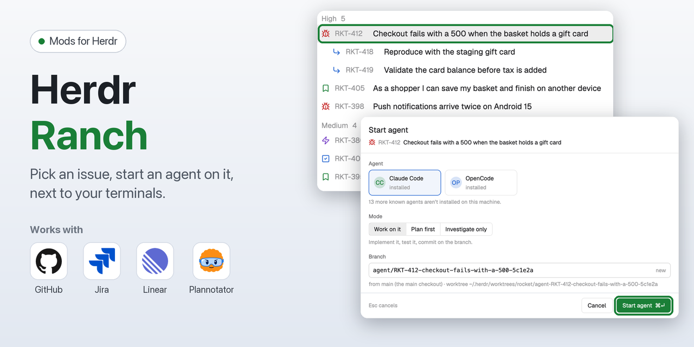
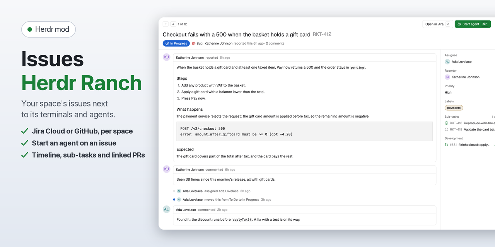
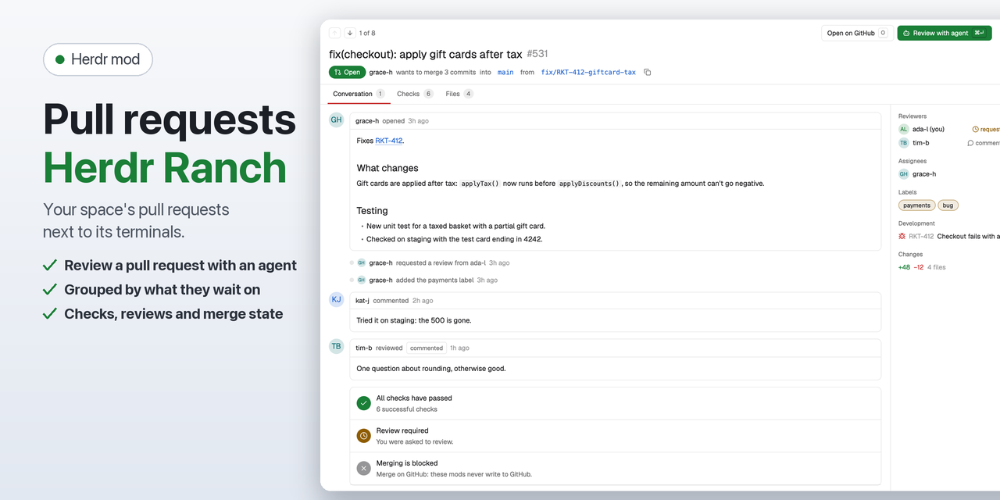
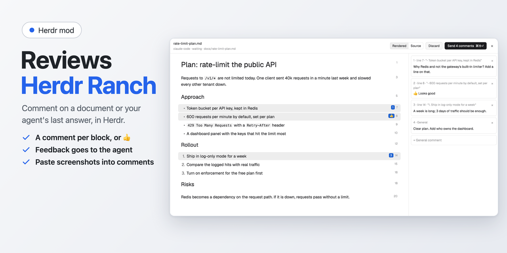
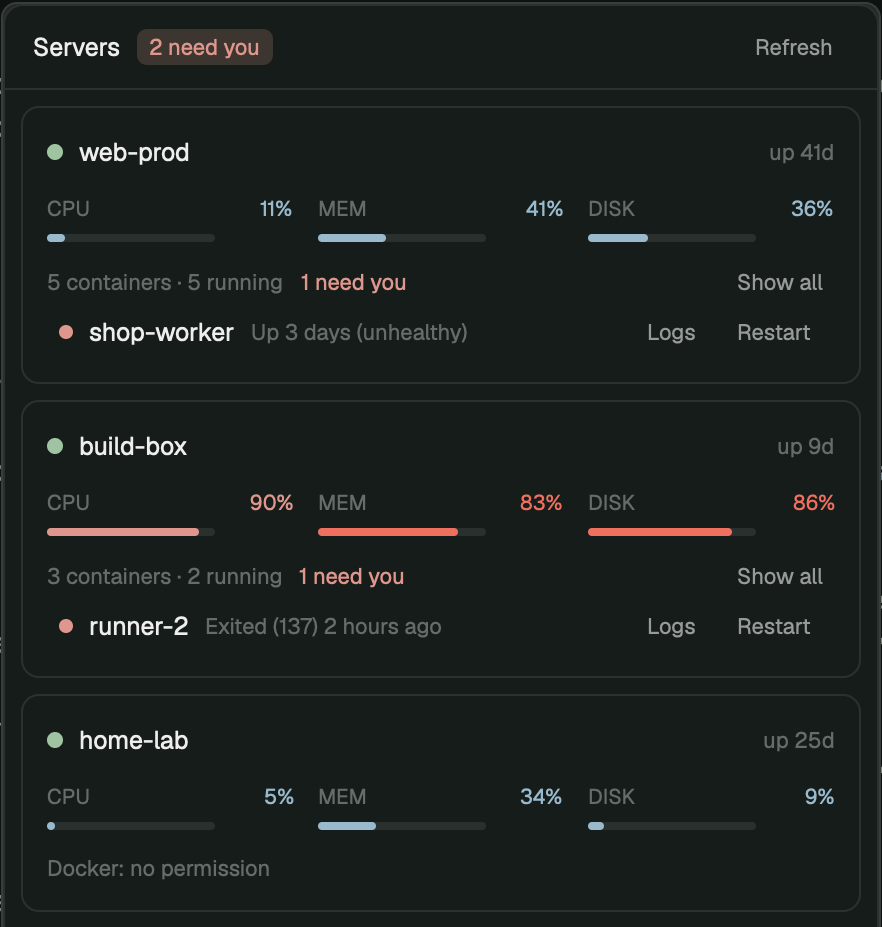
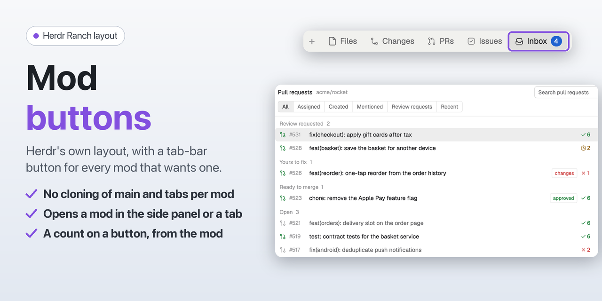

# Herdr Workspace



Mods for the [Herdr](https://herdr.dev) desktop app that show the work of the space you're in next to its terminals and agents, plus a layout that puts them all in one window:

- **Sidebar:** [Spaces](#spaces) (git, links and accounts per space) and [Agents](#agents) (Claude Code's context, tasks and subagents).
- **Tab bar buttons:** [Files](#files), [Changes](#changes), [History](#history), [Issues](#issues), [Pull requests](#pull-requests), [Reviews](#reviews) and [Servers](#servers).
- **Status bar:** [Usage](#usage) (Claude Code and Codex limits, per account).

This is a fork of [jslowack/herdr-ranch](https://github.com/jslowack/herdr-ranch): it adds Usage, accounts per space, a warning for agents that stopped reporting with a button to bring them back, and other changes. The mods keep their `herdr-ranch-*` names, so settings carry over from the original.

**It's opinionated.** It assumes code on GitHub, issues in Jira, Linear or GitHub, and agents working in their own worktrees; the mods only read, you act in the tools themselves. If you work differently, each mod installs on its own and its `RECIPE.md` lets your agent build a variant.

## Install

Tell your agent, in Herdr:

```text
Read ~/.config/herdr-app/AGENTS.md, then clone github.com/garethedwards-tass/herdr-workspace and install everything from it with its install.sh --layout: the mods herdr-ranch-spaces, herdr-ranch-agents, herdr-ranch-files, herdr-ranch-changes, herdr-ranch-history, herdr-ranch-issues, herdr-ranch-prs, herdr-ranch-reviews (with its ranch-review CLI and skills), herdr-ranch-usage and herdr-ranch-servers, the mod-buttons layout, and their keys.json entries; then switch to the mod-buttons layout.
```

Or in a terminal:

```sh
git clone https://github.com/garethedwards-tass/herdr-workspace && cd herdr-workspace && ./install.sh --layout
herdr-app do layout.switch '{"name":"mod-buttons"}'
```

`install.sh` links each mod from your clone into `~/.config/herdr-app/mods`, so a `git pull` updates them in place. You get Spaces and Agents in the sidebar, **Files**, **Changes**, **History**, **Issues**, **PRs**, **Reviews** and **Servers** buttons in the tab bar, and Usage in the status bar.

Already using jslowack/herdr-ranch? Run this clone's `install.sh` instead: it replaces the links with the same names, and your space links, accounts and settings stay.

**Needs:** [`gh`](https://cli.github.com) signed in, and `git`. `curl` for the avatars in Pull requests. Jira and Linear only for what you use; Node.js for Reviews; [Claude Code](https://claude.com/claude-code) for Agents' details and Usage (Codex too, if you use it); Docker (or Rancher Desktop, OrbStack) for Servers' containers. Rust to build `ranch-highlight` (optional). Tested on macOS; Linux and Windows follow their documented commands.

One mod at a time, keyboard shortcuts and updating: see [Install and update](docs/guide.md#install-and-update).

## Issues



The space's issues from Jira Cloud, Linear or GitHub. Each issue opens as a page like GitHub's. **Start agent** (⌘↵) opens a coding agent on it, in a new git worktree and space.

Link a space once from the cog: [Link a space](docs/guide.md#link-a-space), [Connect Jira](docs/connect-jira.md), [Connect Linear](docs/guide.md#connect-linear). More in [the guide](docs/guide.md#issues).

## Pull requests



The space's pull requests, grouped by what each one waits on: review requested, yours to fix, ready to merge. A page per pull request with checks, files and a merge box. **Agent review** checks it out, builds, tests and reports, without writing to GitHub.

More in [the guide](docs/guide.md#pull-requests).

## Reviews



Read what your agent wrote, comment on it in Herdr, and send the comments back to the agent. In Claude Code, type `/herdr-ranch-review <file>` for a plan or document the agent wrote to disk, or `/herdr-ranch-review-last` for the answer it just gave in chat. While the review waits, the agent shows under **Needs you**; click it there and the review opens. Click a block to comment on it, paste a screenshot, or give a 👍, then **Send N comments** (⌘⇧↵). The agent gets one message that quotes each block with your comment, and revises. **Approve as is** tells it to carry on; **Discard** sends nothing. The Reviews button counts what waits on you, in this space or all.

More in [the guide](docs/guide.md#reviews).

## History

The git commit history of the repository you're in, next to Files and Changes: by day, searchable across the whole history (`author:`, `path:`, `code:`, `since:`, a sha), and each commit's changes as diffs, unified or split. Only `git`, read only. See its [RECIPE.md](herdr-ranch-history/RECIPE.md).

## Changes

The uncommitted changes of the repository you're in, behind the tab bar's **Changes** button in the mod-buttons layout: every file as a card with its diff, unified or split and syntax highlighted, and a commit box. See its [RECIPE.md](herdr-ranch-changes/RECIPE.md).

## Files

Herdr's Files panel with syntax colors from `ranch-highlight`, behind the tab bar's **Files** button in the mod-buttons layout; **Editor** switches to Herdr's own editor. See its [RECIPE.md](herdr-ranch-files/RECIPE.md).

## Spaces

Herdr's spaces list with git, links and accounts, in the sidebar of the mod-buttons layout. Each space has a git chip (its branch and state, green when in sync; a click opens git and worktree actions), its terminals and agents, and its account as a coloured letter (a click opens the Link dialog, where you set its Jira, Linear or GitHub link and its account). Worktree spaces sit under their repository's space, followed by its worktrees without a space (right-click to create a space there or delete it). A worktree a lane serves (see [Servers](#servers)) shows the lane's badge, such as **L2**; a click opens its site. **New worktree** starts from a branch or from one of your issues.

**Accounts:** a space's terminals can start as one of your accounts: a Claude Code login (its config folder) and a GitHub account (`GH_TOKEN` from `gh auth token --user`), so work and personal repositories each use their own. A filter at the top shows one account's spaces. See its [RECIPE.md](herdr-ranch-spaces/RECIPE.md).

## Agents

Herdr's agents list with Claude Code's own records, in the sidebar of the mod-buttons layout: the context each Claude Code agent uses, a popup with its model, usage, tasks and subagents, and its task list and running subagents under its row. An agent that stopped reporting its status still shows, with a warning and **Bring back**, which restarts its Claude Code session in place, as the same account. See its [RECIPE.md](herdr-ranch-agents/RECIPE.md).

## Usage

Claude Code and Codex usage limits (the 5-hour session, weekly and per-model windows) in the status bar of the mod-buttons layout, with one Claude Code reading per account the Spaces list keeps, each marked with the account's coloured letter. Hovering shows every window, time to reset and the focused session's context. Adapted from [VladTemp27's usage-limits](https://github.com/VladTemp27/herdr-mods/tree/main/usage-limits) (Apache-2.0). See its [RECIPE.md](herdr-ranch-usage/RECIPE.md).

## Servers



Every machine Herdr is connected to, plus this computer, behind the tab bar's **Servers** button (or ⌘⇧M as a popup): CPU, memory and disk meters, uptime, and each machine's Docker containers. Unhealthy, restarting or crashed containers are always listed, the rest on **Show all**; each has **Logs** and **Restart** (asks first), and a notification comes when one goes down or comes back. It finds `docker` on the PATH or in the usual install folders (Rancher Desktop, OrbStack, Docker Desktop, Homebrew). From [obrunogonzaga's servers-panel](https://github.com/obrunogonzaga/herdr-mods/tree/main/servers-panel) (MIT). See its [RECIPE.md](herdr-ranch-servers/RECIPE.md).

## Highlighting

The diffs in Pull requests and History are syntax highlighted by `ranch-highlight`, a small tree-sitter helper in Rust (`ranch-highlight/`): CFML (with cfscript, `<cfquery>` SQL and embedded HTML, CSS and JS) and 19 other common languages. `install.sh` builds it when Rust is installed ([rustup.rs](https://rustup.rs)); without it the diffs stay plain.

## The mod-buttons layout



Herdr's own layout, with a tab-bar button for every installed mod that declares one. It works for any mod, not only these. To add a button to your own mod, see [mod-buttons/RECIPE.md](mod-buttons/RECIPE.md). [herdrdev/herdr-app#246](https://github.com/herdrdev/herdr-app/issues/246) asks for this in Herdr itself.

## What it touches

- **Read only.** Nothing is written to Jira, Linear or GitHub. Start agent creates a local worktree and branch, and pushes nothing.
- **Tokens** go to your system's credential store, never into Herdr's settings.

Every program, host and file it uses: [docs/reference.md](docs/reference.md#what-they-run-and-store).

## Recommended

Mods by others that go well with these. Install them the way their own README says; the mod-buttons layout gives each a button, even when its `mod.json` declares none.

### Automations

[DnzzL/herdr-automations](https://github.com/DnzzL/herdr-automations) (MIT): agent prompts on a schedule, such as a morning triage or a nightly dependency check. A run opens as a space in the app. Follow its section "In the Herdr desktop app"; you can skip its layout step, the mod-buttons layout adds its button.

## More

- [Guide](docs/guide.md): install options, linking a space, Start agent, your own prompts.
- [Reference](docs/reference.md): what runs and what is stored, install flags, keys.
- [CHANGELOG.md](CHANGELOG.md): what changed per version.
- Each mod's `RECIPE.md`: the brief an agent builds it from ([Spaces](herdr-ranch-spaces/RECIPE.md), [Agents](herdr-ranch-agents/RECIPE.md), [Files](herdr-ranch-files/RECIPE.md), [Changes](herdr-ranch-changes/RECIPE.md), [History](herdr-ranch-history/RECIPE.md), [Issues](herdr-ranch-issues/RECIPE.md), [Pull requests](herdr-ranch-prs/RECIPE.md), [Reviews](herdr-ranch-reviews/RECIPE.md), [Usage](herdr-ranch-usage/RECIPE.md), [Servers](herdr-ranch-servers/RECIPE.md), [mod-buttons](mod-buttons/RECIPE.md)).
- The original: [jslowack/herdr-ranch](https://github.com/jslowack/herdr-ranch).
- [CONTRIBUTING.md](CONTRIBUTING.md): tests, shared code, how the repository is laid out.

## License

[MIT](LICENSE), from jslowack/herdr-ranch. Usage (`herdr-ranch-usage/`) is Apache-2.0: see its [LICENSE](herdr-ranch-usage/LICENSE) and [NOTICE](herdr-ranch-usage/NOTICE). Servers (`herdr-ranch-servers/`) is MIT from Bruno Gonzaga: see its [LICENSE](herdr-ranch-servers/LICENSE) and [NOTICE](herdr-ranch-servers/NOTICE).
