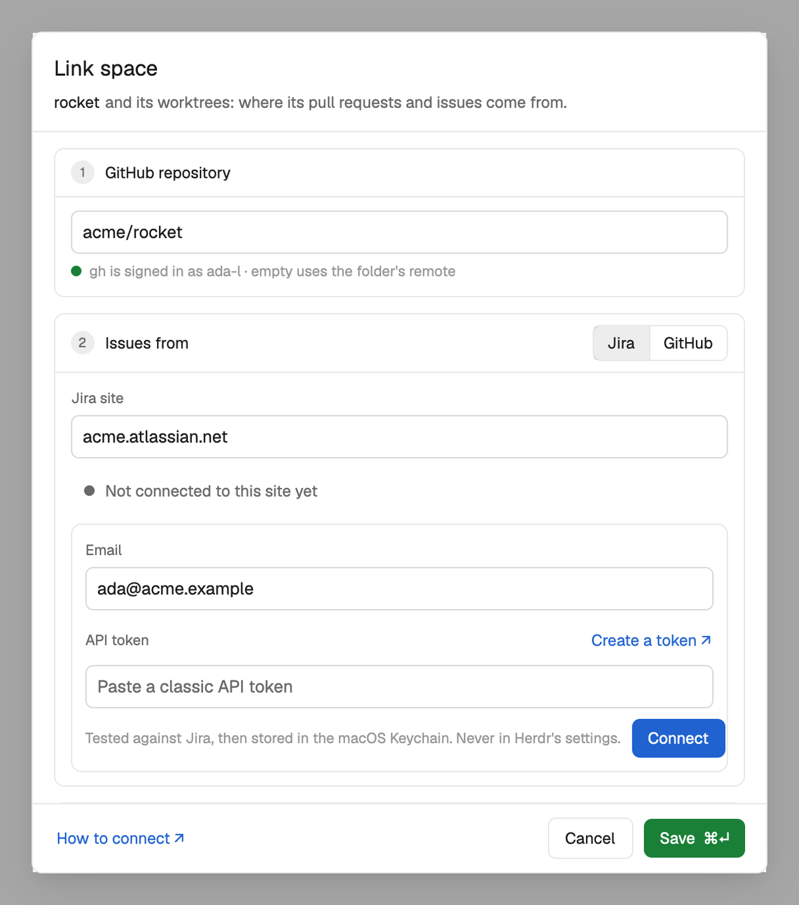

# Connect Jira

The issues list reads Jira Cloud with your own account, through Jira's REST API. It needs your email and a **classic API token**. This page covers macOS, Linux and Windows.



The quickest way is the **Link space** dialog (the cog in the Issues or PRs list, then **Link space…**): pick **Jira**, enter the site, then your email and token, and press **Connect**. The dialog tests the token against Jira first and only stores one that works. The sections below are for setting it up by hand, and for when something goes wrong.

## 1. Create a classic API token

1. Open <https://id.atlassian.com/manage-profile/security/api-tokens>.
2. Choose **Create API token** (not "Create API token with scopes").
3. Give it a name, such as `Herdr`, and an expiry date, then copy the token.

**Why classic:** a token with scopes only works on `api.atlassian.com`, and these mods call your site (`example.atlassian.net`) directly. Jira answers a scoped token with 401.

## 2. Store it

The mods look for the sign-in in this order, per site (for `example.atlassian.net`):

1. The system's credential store, item `herdr-jira:example.atlassian.net` (account: your email, secret: the token).
2. `JIRA_EXAMPLE_EMAIL` and `JIRA_EXAMPLE_API_TOKEN`.
3. `JIRA_EMAIL` and `JIRA_API_TOKEN`.
4. `ATLASSIAN_USERNAME` and `ATLASSIAN_API_KEY`.

The token is never written to Herdr's settings or shared state. The system store keeps it out of plain-text files; like any store, it doesn't hide it from programs you run as yourself (including the agents you start).

The generic variables (`JIRA_EMAIL`, `ATLASSIAN_*`) are only used for Atlassian Cloud hosts. A self-hosted or other host needs the per-site variables or the dialog, and must be typed in Link space once before the mods send a sign-in there. So a repository's `.herdr/jira.toml` can't send your token to a site you didn't link or type yourself: a sign-in only goes to Atlassian Cloud hosts (`*.atlassian.net`, `*.jira.com`) and to hosts you entered.

### macOS: Keychain

In the Link space dialog, **Connect** stores it for you. By hand, in zsh (paste the token at the prompt; it isn't shown):

```sh
read -rs "t?Jira token: " && security add-generic-password -U -s herdr-jira:example.atlassian.net -a you@example.com -w "$t"; unset t
```

Don't use a bare `-w` and paste at its own prompt: that prompt keeps only the first 128 characters, a classic token is longer, and Jira answers 401.

Remove it: `security delete-generic-password -s herdr-jira:example.atlassian.net`, or **Remove sign-in** in the dialog.

### Linux: Secret Service (GNOME Keyring, KWallet)

**Connect** in the dialog uses `secret-tool`. Install it if it's missing: `libsecret-tools` on Debian and Ubuntu, `libsecret` on Fedora and Arch. By hand (paste the token at the prompt):

```sh
secret-tool store --label="Herdr Jira example.atlassian.net" service herdr-jira site example.atlassian.net account you@example.com
```

Remove it: `secret-tool clear service herdr-jira site example.atlassian.net`.

Without a running keyring (a server, a minimal desktop), or while the keyring is locked, the mods can't read it: unlock it, or use environment variables instead.

### Windows: Credential Manager

**Connect** in the dialog stores a generic credential through PowerShell; nothing to install. By hand, in PowerShell:

```powershell
[void][Windows.Security.Credentials.PasswordVault,Windows.Security.Credentials,ContentType=WindowsRuntime]
$t = Read-Host "Jira token" -AsSecureString
$plain = [Runtime.InteropServices.Marshal]::PtrToStringAuto([Runtime.InteropServices.Marshal]::SecureStringToBSTR($t))
(New-Object Windows.Security.Credentials.PasswordVault).Add((New-Object Windows.Security.Credentials.PasswordCredential('herdr-jira:example.atlassian.net', 'you@example.com', $plain)))
Remove-Variable plain, t
```

It shows up in **Credential Manager → Windows Credentials**. Remove it there, or with **Remove sign-in** in the dialog.

### Environment variables (any platform)

Set `JIRA_EMAIL` and `JIRA_API_TOKEN` (or the per-site pair) where Herdr can see them:

- **macOS:** in `~/.zshenv`; the mods also ask a login `zsh`, so it works even when Herdr was started from the Dock.
- **Linux:** in your shell's login profile (`~/.profile`, `~/.bash_profile`); the mods ask a login `$SHELL` (a POSIX shell: with fish or nushell, put them in `~/.profile` and start Herdr from a login session).
- **Windows:** as user environment variables (Settings → System → About → Advanced system settings → Environment Variables), then restart Herdr.

## 3. Link the space

In **Link space**, pick **Jira**, check the site, pick the project and, if you want, a filter (Current sprint, All open, Assigned to me, or your own JQL). Worktree spaces of the same repository follow the link.

## When it doesn't work

| What you see | Why, and what to do |
|---|---|
| "Jira doesn't accept this token" (401) | A scoped token, an expired token, or the wrong email. Create a classic token and connect again. |
| 401 after pasting at the `security` prompt (macOS) | That prompt kept only 128 characters. Use the dialog or the `read -rs` command above. |
| "secret-tool isn't installed" (Linux) | Install `libsecret-tools` or `libsecret`, or use environment variables. |
| Variables are set but not found | Herdr was started before you set them, or they're in a file a login shell doesn't read. Restart Herdr; on macOS put them in `~/.zshenv`. |
| Several Jira sites | Each site has its own item (`herdr-jira:<site>`) or its own `JIRA_<SITE>_EMAIL` and `JIRA_<SITE>_API_TOKEN`. |
| "Connect first to search projects; a typed key works too." | Project search uses the sign-in. Connect, or type the project key yourself. |
