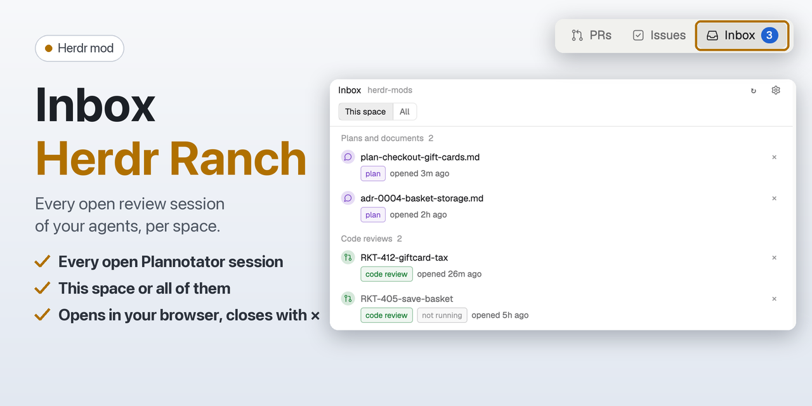

# Inbox · Herdr Ranch

The open Plannotator sessions (the plans, documents and code reviews your agents opened for you) for each Herdr space. A list next to your terminals; a click opens the page in your browser. It uses Plannotator's CLI, plus a watch on `~/.plannotator/sessions` to know when to refresh.

## What you see

- **Header:** "Inbox", the shown space's name in `dim` (or "every project"), ↻ (Herdr's spinner while loading), a cog, and × when open as a window. Under it a segmented **This space | All**.
- **Plans and documents** and **Code reviews**, each with a count: one row per open session (`plannotator sessions --json`), newest first: a tinted circle with a comment icon (purple, annotate) or a pull request icon (green, review), what it reviews (the label without its `annotate-` or `review-` prefix; "Last answer" for `annotate-last`), a pill ("plan" or "code review") and "opened 12m ago" (with the space or project name in All).
- **Not running:** a session whose port no longer listens shows in `muted` text with a gray "not running" pill (only its record is left).
- **×** at the end of every row turns into a red confirm (**Stop session** for a running one, **Remove** for a stopped one) with **Cancel**. Stopping ends the session's process (its page closes; the agent waiting on it gets no feedback); only a process whose command line is Plannotator's is stopped (`ps -p <pid> -o command=`; on Windows its process name). Then `plannotator sessions --clean`; when Plannotator keeps the record anyway (its old process id now belongs to another program), the record file `~/.plannotator/sessions/<pid>.json` is removed, but only while nothing listens on the session's port.
- **Empty:** "No Plannotator session open for this space." (or without "for this space"), or "Plannotator isn't installed: plannotator.ai".
- **Footer:** the keys (↑ ↓ move, ↵ open, Esc close in a window).
- **Toast** when a session opens after the list loaded ("A plan is ready to review" / "A code review is ready" with what and where); clicking it opens the newest session.
- **Button count** (mod-buttons): running sessions in the shown space, through `shared("mod-badges")["herdr-ranch-inbox"][<space id>]`.

### The cog

**Opens in** Panel | Tab.

**Needs:** [Plannotator](https://plannotator.ai) (`plannotator` on the PATH of a login shell). Optional: the [mod-buttons](../mod-buttons/RECIPE.md) layout for the **Inbox** button.

## How it behaves

- **Running or not:** whether a process listens on the session's port (`lsof -nP -iTCP:<port> -sTCP:LISTEN -t`; PowerShell `Get-NetTCPConnection` on Windows). Herdr's `fetch` can't reach local pages, so it isn't used.
- **When it refreshes** (only while shown): when a session opens or closes (Herdr's `watchFolder` on `~/.plannotator/sessions`, where Plannotator writes and removes a record per session), when Herdr's window comes back to the front (checked every second with `window.is_window_active()`, so answering in the browser and coming back shows the change), on ↻, and every 30 seconds as a fallback.
- **Sessions:** `plannotator sessions`: `--json` when it answers ({ index, mode, url, port, pid, project, label, startedAt }; in the CLI's help, not its docs), else the documented text (`#N  mode  -  project  url  age ago  file`). A session's folder comes from its process (`lsof -a -p <pid> -d cwd -Fn` on macOS, `readlink /proc/<pid>/cwd` on Linux), else the folder of the absolute file it reviews; otherwise the `project` name (the folder's name, cut to 30 characters) is used.
- **This space:** a session's folder is the space's folder, inside it, its repository's main checkout, or one of that repository's worktrees (`~/.herdr/worktrees/<repo>/…`); by name, the project equals the folder's or repository's name, or starts it when cut.
- **Opening:** a session's URL in the default browser (`open`, `xdg-open` or `rundll32`).
- **`plannotator`** is found once through a login shell (`zsh -lc` on macOS, `sh -lc` on Linux, PowerShell `Get-Command` on Windows), since Herdr's own PATH may lack `~/.local/bin`.
- **In the Pull requests mod:** **Review in Plannotator** runs `plannotator review <url>` in a new tab of the space.
- **Keys:** Up/Down move the highlight, Enter opens. Commands `herdr-ranch-inbox.<name>`: `down`, `up`, `open`, `latest` (the newest session), `refresh`, `focus`, `close`.

## Built from

- `mods/herdr-ranch-inbox/main.js` (the list), with the repository's `shared/` copied in: `inbox.js` (reading sessions and their folders, `sessionInSpace`), `links.js`, `page-kit.js` and the rest.
- `mod.json`: `place: none`, a window overlay (60% × 80%), `button: { label: "Inbox", icon: "inbox.svg", opens: "panel", order: 30 }`.
- herdr: `spaces`, `shared`, `setShared`, `theme`, `props`, `exec`, `run`, `notify`, `closeOverlay`, `nextCommand`, `watchFolder`, `home`.
- The global `window.is_window_active()` (the window back in front).
- Programs: `plannotator`, `ps`, `lsof` (macOS), `readlink` (Linux), `open` / `xdg-open` / `rundll32`.

## Watch out

- Sessions come from the CLI only: the folder `~/.plannotator/sessions` is watched to know when to ask again, not read, and its pages' internal API isn't used, since both can change. The one write there is removing a stale record file (see **×** above).
- Annotating and answering stay in Plannotator's page.

## Done when

- `herdr-app check mods/herdr-ranch-inbox` passes.
- With a `plannotator annotate` page open from the shown space's folder, the list shows it under Plans and documents, the Inbox button shows 1, and a click opens it.
- A `plannotator review` page shows under Code reviews.
- A click opens the session's page in the default browser.
