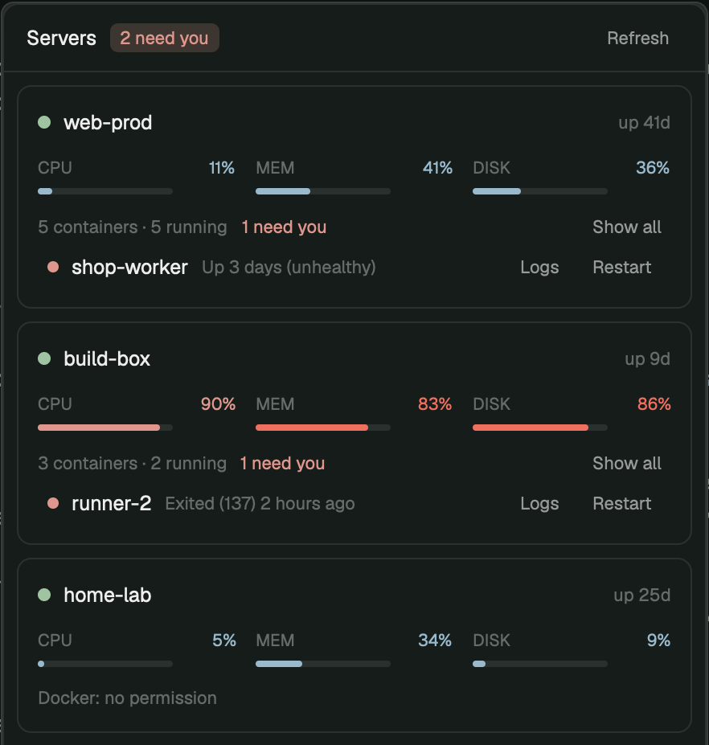

# Servers

servers-panel from [obrunogonzaga/herdr-mods](https://github.com/obrunogonzaga/herdr-mods/tree/main/servers-panel) (MIT, see `LICENSE` and `NOTICE`), renamed `herdr-ranch-servers` and given a tab-bar button for the mod-buttons layout. Otherwise unchanged.

Every machine Herdr is connected to, plus this computer, in one panel: CPU, memory and disk
meters, uptime, and the Docker containers on each. Containers that need you (unhealthy, restarting,
or exited with an error) are always listed; the rest show on `Show all`. Each container row opens its
logs or restarts it after an inline confirm. A notification comes when a container goes down or comes
back. It opens as a popup over the window (`cmd-shift-m`), and fits a side panel of a cloned layout
just as well.

## What you see (herdr-ranch)

Restyled like the Spaces and Agents lists; the original look is described after this section.

- **Header** (40px): `Servers` in `muted`, a red pill `n need you` when containers do, and a refresh icon button (24px, `refresh.svg`; a spinner while looking).
- **A machine** is a row like a space (31px, rounded 8; the fold caret at its left edge in a 22×28 target, remembered; an 18px slot with a server icon, or a monitor for This computer; the 13px name 9px on) with a **status pill** on the right in the Spaces git pill's style (92×20, rounded 4, a dot, tinted border and fill): `n need you` or `offline` / `error` in red, running/total and its memory (`6/6 · 77%`) in green, amber (red from 90%) when memory is at 75% or more, grey for `no docker` or `…`.
- Under it, unfolded: **its containers** (31px rows from 27px in, a 17px icon slot, 13px names), needing-you first, each with a **pill** (104 wide): a fine one's memory from `docker stats --no-stream` (`2.9 GB · 95%`, the percentage of its limit), green, amber from 75% and red from 90%; `starting`, `restarting` in amber; `unhealthy`, `exit 137` in red; `stopped` in grey. No project or uptime on the row: the menu has them, with memory and CPU.
- **Lanes** (`lanes.js`): a lane is one copy of a stack's app containers, with its own site and database, that a branch or worktree is served on. Read from each container's own labels (the same `docker ps`; no CLI): `lane` (its number), `lane.url`, `lane.database`, `lane.owner` (who or what it's held for; empty: free), `lane.branch`, `lane.serves` (`repo=path` pairs joined by `;`). Whatever maintains the lanes writes them as compose `labels:` on each lane container. Containers of the same compose project (`com.docker.compose.project.working_dir`) without `lane` are its **Shared** ones; containers with no lane labels anywhere in their project list as before. A **lane row** (31px, from 27px in, a layers icon, `Lane N` and its host in 12px `dim`) has a pill: the owner (else branch) in `accent`, `free` in green, `stopped` in grey; its containers sit one step in, then a **Shared** row and the project's other containers. The state comes from the containers: running, partly running, stopped.
- **Lane menu** (its pill, or a right-click on its row): `Lane N` and host; state and container count; database; who holds it (owner, branch) or `Free: no one holds it`; **Serving**: each repo → worktree path, or `Every repo from its main checkout`. **Open site**, **Copy URL**, **Go to space <name>** (the Herdr space whose folder is a served worktree or the owner's path).
- **Menus** (popups at the pointer, in the Spaces menu's style): a click on a pill (only there: a machine row's click folds it, a container row's does nothing), or a right-click anywhere on a row. A container's: its name and Docker's status (how long it's up), `Memory 2.853GiB / 3GiB (95.1%) · CPU 1.7%`, image, project and machine; **Logs…**, **Restart** (the first click turns it red, `Restart <name>? Click again`; then it runs and notifies), **Copy name**, **Copy ID**. A machine's: name, uptime, the meters and container counts; **Refresh**, **Hide stopped containers** / **Show stopped containers** (shared `ranch-servers.hideStopped`). A menu's restart asks the panel to look again through shared `ranch-servers.refresh`.

## What you see (original)

One column on the `background` color, radius 10, a 1px `border`, base type 12.5px. Top to bottom:

- **Header**, 42px tall, 14px side padding, a 1px `border` line under it: `Servers` semibold; when
  any container needs you a pill `2 need you` (11px `ansi1` on `ansi1` at 20% alpha, 6px side
  padding, radius 5); on the right a `Refresh` button (11px `muted`, 26px tall, radius 7; `…` while
  loading).
- **Machine cards**, scrolling, 8px padding and gaps. Each card: `surface`, radius 9, 1px `border`,
  12px padding, 10px between its parts:
  - Head: an 8px dot (`ansi2` when it answered, `ansi1` on error, `dim` before the first answer),
    the machine's name semibold (Herdr's machine name; `This computer` last), and `up 41d` in 11px
    `dim` on the right (hours under a day).
  - Three meters side by side, 12px apart: `CPU`, `MEM`, `DISK` in 10.5px `dim` with the percentage
    on the right, over an 84×4px bar (radius 2, `raised` track). Color: `accent`, `blocked` from
    75%, `ansi1` from 90%. CPU is the 1-minute load over the CPU count, capped at 100%; memory is
    total minus available; disk is used over used plus free on `/`.
  - Docker: `15 containers · 14 running`, `1 need you` in `ansi1` when some do, and `Show all` /
    `Hide` on the right, 11px. Then container rows, 26px, radius 6, `hover` under the pointer: a 7px
    dot by health (`ansi2` ok; `blocked` starting or restarting; `ansi1` unhealthy or down; `dim`
    stopped with exit 0 and others), the name (up to 150px), Docker's status in 11px `dim`
    truncated, and `Logs` and `Restart` (11px `muted`, `raised` under the pointer). Rows sort
    containers that need you first, then by Compose project and name.
  - Instead of the meters or Docker: `Loading…`, `Offline`, the error in `ansi1`, `Docker: no
    permission`, `Docker: not installed`, or `No containers`.
- **Restart confirm**: the row turns into `Restart shop-worker?` in `ansi1` with `Restart` (in
  `ansi1`) and `Cancel`; while it runs the status reads `Restarting…` in `blocked`.
- **Logs dialog** (760×520, `popover`): a 42px header with the container's name semibold, `hetzner ·
  last 300 lines, newest first` in `dim`, `Refresh` and `Close`; below, a read-only code view in the
  terminal font at 11.5px, no line numbers, newest line on top.

As a popup it is 440×640 px, centered.

## How it behaves

- It doesn't show agent statuses: it watches machines, not agents.
- Machines are `machines()` (deduplicated by name, sorted) plus this computer; one marked
  `unavailable` shows `Offline` and isn't asked.
- Every 30 s and on `Refresh`, all machines are asked at once: one `exec("sh", ["-c", PROBE], { on })`
  each. The script prints `key=value` lines: `/proc/loadavg` or `sysctl vm.loadavg`, `nproc` or
  `hw.ncpu`, `free -b` or `hw.memsize` with `vm_stat` (free + inactive + speculative pages), `df -Pk
  /`, `/proc/uptime` or `kern.boottime`, and `docker ps -a` with ID, name, state, status, image and
  the `com.docker.compose.project` label, tab-separated. Decimal commas (some macOS locales) are
  read too.
- Health: running is `ok`, `unhealthy` with `(unhealthy)` in the status, `starting` with `health:
  starting`; `restarting`; exited or dead is `stopped` with exit code 0, else `down`. Unhealthy,
  restarting and down need you.
- Notifications compare each look with the last one for that machine: a container that starts
  needing you gives `shop-worker is unhealthy` (error, body: the machine); one that stops needing you
  gives `shop-worker is back` (success, 6 s). The first look after start says nothing.
- `Restart` → confirm → `docker restart -- <name>` on that machine (arguments, no shell), then that
  machine is asked again. A failure notifies with Docker's first error line.
- `Logs` opens the dialog: `docker logs --tail 300 --timestamps -- "$1"` with the name as `$1`,
  wrapped in `timeout 15` where the machine has it. Exit 124 shows `docker logs didn't answer in 15
  s…`. Terminal color codes are stripped. `Refresh` reads again.
- `Show all` is per machine and lasts while the panel is open.

## Built from

- `mods/herdr-ranch-servers/main.js`: picks the view from `props().view` (and `props().menu` → `menu.js`, herdr-ranch) (the first `init` argument doesn't
  carry props): `panel.js` (the panel, a plain class) or `logs.js` (`{ view: "logs", machine,
  container }`, opened with `openOverlay({ mod: "herdr-ranch-servers", kind: "dialog", width: 760, height: 520,
  props })`). `mod.json`: `{ "place": "none", "title": "Servers · Herdr Ranch", "overlay": { "width": 440, "height": 640 }, "button": { "label": "Servers", "icon": "server.svg", "opens": "panel", "order": 40 } }`: the mod-buttons layout gives it a **Servers** button beside Files and Changes, opening it in the side panel.
- `mods/herdr-ranch-servers/probe.js`: the script and pure functions: `parseProbe`, `containerHealth`,
  `needsAttention`, `usage`, `containerAlerts`.
- `mods/herdr-ranch-servers/demo.js`: three made-up machines for screenshots, shown when the panel gets
  `{ demo: true }`; it then runs nothing.
- `keys.json`: `{ "global": { "cmd-shift-m": "mod.open:herdr-ranch-servers" } }`.
- `herdr` functions: `machines`, `exec`, `notify`, `openOverlay`, `props`, `closeOverlay`,
  `settings`, `theme`. Shipped icon: `mods/workspace-chrome/server.svg` for a tab-bar button.
- Runs programs on every machine Herdr reaches and can restart containers. Reads nothing outside
  its own folder.

## Watch out

- **Finding docker** (herdr-ranch): Herdr's processes get a login shell's PATH, which misses folders added in `~/.zshrc` (Rancher Desktop's `~/.rd/bin`). So every script first sets `$D` to `docker` on the PATH, else the first of the usual install folders that exists: on macOS Rancher Desktop (`~/.rd/bin`, and inside the app), OrbStack, Docker Desktop and Homebrew; on Linux `/usr/bin` and snap; on Windows (only under Git for Windows' `sh`) Docker Desktop, Rancher Desktop and Podman. None found: `Docker: not installed`. The meters' probe stays Linux and macOS only, as upstream.

- `docker` must be usable by the user Herdr connects as (the `docker` group); otherwise the card
  says `Docker: no permission` and still shows the meters.
- `docker logs` can hang: on one host it did right after Docker rotated a container's json log (the
  live file was empty). The 15 s deadline needs `timeout(1)`; without it the dialog waits for
  Herdr's 30 s `exec` limit.
- The code view can't scroll itself, so logs are reversed to put the newest line on top.
- Notifications only come while the panel is alive: in the shown layout (hidden in a stack is fine)
  or open as a popup.
- In the mod-buttons layout it docks in the side panel by itself: its `mod.json` declares the **Servers** button, and the tab bar adds its `panel-body` block.
- `herdr-app check mods/herdr-ranch-servers` passes (it renders without props).
- `cmd-shift-m` opens the popup with a card per connected machine and this computer, with meters
  and container counts.
- A machine where the user isn't in the `docker` group shows `Docker: no permission`.
- `Logs` on a running container shows its latest lines, newest first, without color codes.
- `Restart` asks first; `Cancel` puts the row back.
- `node --test` passes (`parseProbe`, `containerHealth`, `usage`, `containerAlerts`).
